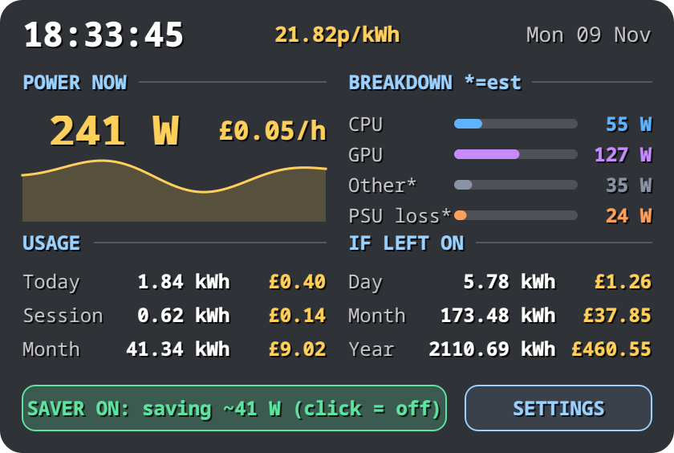

# Linux Powermon

> **Linux only.** Reads Linux `/sys` interfaces (hwmon, powercap, DRM) and uses `pkexec` for the optional energy saver. It does **not** run on Windows or macOS.

A **transparent desktop overlay** that shows how much electricity your PC is using and what it costs. You enter your **unit rate** (the price per kWh on your bill), and it works out the cost per hour, today, this session, this month and a projection. One click on **Energy Saver** drops the CPU and GPU to their lowest power state.

Same look and feel as [Linux Sysmon](https://github.com/kranmal/linux-sysmon): a single Python + Qt (PySide6) file that sits on your desktop.


*Screenshot taken with `--demo` (fake data).*

## Features

| Area | Shows |
|------|-------|
| **Power now** | estimated draw **at the wall** in watts, cost per hour, 60 s graph |
| **Breakdown** | CPU, GPU, "other" and PSU loss, in watts |
| **Usage** | kWh and cost for today, this session and this month (saved between runs) |
| **If left on** | cost per day / month / year if the machine keeps drawing the current power |
| **Settings** | button to change currency, unit rate, "other parts" watts and PSU efficiency any time |
| **Energy Saver** | button that cuts CPU and GPU power to the minimum, and restores it on the next click |

Interaction: **drag** with the left mouse button, **right-click** for settings, reset, opacity presets and quit.

## How it works

A PC has no wall-power sensor, so Powermon measures what it can and estimates the rest. **Everything estimated is marked with `*` on screen.**

```
wall watts = (CPU + GPU + other) / PSU efficiency
cost / h   = wall watts / 1000 x unit rate
usage      = wall watts x elapsed time, added up every second (kWh)
```

| Part | Source | Measured or estimated |
|------|--------|-----------------------|
| **CPU** | hwmon `zenergy` energy counter (AMD Ryzen), else Intel RAPL (`/sys/class/powercap`). Power = change in the energy counter / time | **measured**. If neither exists it falls back to a rough model (10 W idle up to 65 W by CPU load) and shows `CPU*` |
| **GPU** | hwmon `amdgpu` `power1_average` or `power1_input` | **measured** (AMD only; other GPUs show `GPU?` and count as 0 W) |
| **Other** | a number you set (default 35 W) for motherboard, RAM, drives, fans, USB | **estimated** |
| **PSU loss** | wall watts minus DC watts, from the PSU efficiency you set (default 90 %) | **estimated** |

Accuracy: expect the total to be within roughly 10 to 15 % of a plug-in power meter. For better accuracy, plug the PC into a meter once, compare it with the wall figure, and adjust the **Other** watts in Settings until they match.

Usage is stored in `~/.local/share/powermon/usage.json` (one number per day) and only counts while Powermon is running. Settings are in `~/.config/powermon/config.json`.

## Energy Saver

The button runs the helper `powermon-saver` as root through `pkexec` (you get a normal polkit password prompt). It saves the current values to `/run/powermon-saver.json`, then:

| Setting | Saver ON |
|---------|----------|
| CPU boost (`/sys/devices/system/cpu/cpufreq/boost`) | off |
| CPU governor (`scaling_governor`) | `powersave` |
| CPU max frequency (`scaling_max_freq`) | lowest supported |
| AMD GPU `power_dpm_force_performance_level` | `low` |
| AMD GPU power cap (`power1_cap`) | its minimum |

Clicking again restores exactly the saved values. A reboot also resets everything, because these are runtime sysfs settings. The button state is read from the system, so it stays correct if something else changes the settings.

Things to know:

- **It is slow on purpose.** Games, builds and local AI models will crawl until you turn it off.
- On a mostly idle desktop the saving is modest (a few tens of watts at most). Measured on one Ryzen 5 3600 + AMD GPU desktop: about 148 W down to about 109 W.
- **Multi-monitor:** forcing the lowest GPU level can cause flicker on some setups. Turn the saver off if you see it.
- Cores are not taken offline, and no system services are stopped.
- **Security:** `pkexec` runs the helper as root. Install it to a root-owned location with `./install.sh --system-helper` (to `/usr/local/bin`) so a user-level process cannot swap it out. Powermon prefers `/usr/local/bin/powermon-saver` over `~/.local/bin`. The helper only touches the fixed sysfs paths above and validates every value before writing.
- AMD GPU and `acpi-cpufreq`/`amd-pstate`/`intel_pstate` behaviour varies. On drivers where a file doesn't exist, that step is skipped.

## Requirements

- Linux with Python 3.10+
- `PySide6` (Qt 6) and `psutil`
- A polkit agent (any desktop environment has one) for the Energy Saver button
- Sensors: AMD Ryzen with the [`zenergy`](https://github.com/BoukeHaarsma23/zenergy) kernel module, or an Intel CPU with readable RAPL. Without either, CPU power is estimated. Energy counters on some kernels are root-only (e.g. Intel RAPL on recent kernels), in which case the estimate is used.

## Install

```bash
git clone https://github.com/kranmal/linux-powermon.git
cd linux-powermon
pip install --user -r requirements.txt      # or use a venv
python3 powermon.py                         # try it: asks for your unit rate on first run
./install.sh --system-helper --autostart    # launcher + root-owned saver helper + start at login
```

`install.sh` copies the script to `~/.local/bin/powermon`, adds an app-menu entry, and with `--autostart` a login entry. Remove with `./install.sh --uninstall`.

## Usage

```bash
powermon                # run (asks for your tariff the first time)
powermon --setup        # ask for the tariff again
powermon --demo         # fake data, nothing is saved (for screenshots)
```

The first-run dialog asks for:

- **Currency symbol** (default `£`)
- **Unit rate** in pence or cents per kWh, from your bill (e.g. `21.82`)
- **Other parts** in watts (default 35)
- **PSU efficiency** in percent (default 90; 80+ Bronze is about 85, Gold about 90)

Your bill may also have a daily standing charge. Powermon ignores it, because it doesn't depend on usage.

## Positioning (important on Wayland)

Wayland apps cannot place their own window, so the position is set with a KDE Plasma window rule. The helper also keeps the overlay below other windows and hides it from the taskbar, pager and Alt-Tab:

```bash
./kde-window-rule.sh X Y        # logical pixels
./kde-window-rule.sh --remove
```

Bottom-right corner: `X = logical_width - 420 - margin`, `Y = logical_height - 282 - margin`. Get the logical size with `kscreen-doctor -o` (2560x1440 at scale 1.2 is 2134x1200 logical). Example, leaving room for a taskbar: `./kde-window-rule.sh 1694 850`. Restart Powermon after changing the rule. On other desktops use your compositor's window rules and match title or app id `powermon`.

Because it is kept *below* other windows, a maximised or large window can cover it. Use the desktop-show shortcut to see it.

## Troubleshooting

| Problem | Fix |
|---------|-----|
| CPU shows `CPU*` (estimated) | no readable energy counter. On AMD, install the `zenergy` module. Check `ls /sys/class/hwmon/*/name` |
| GPU shows `GPU?` | no `amdgpu` power sensor. Non-AMD GPUs are not supported yet. PRs welcome |
| Saver says "cancelled / not authorised" | you dismissed the password prompt or have no polkit agent running |
| Saver says "powermon-saver not installed" | run `./install.sh` (or `--system-helper`) |
| Saver stuck ON after a crash | click the button, or run `pkexec powermon-saver off`, or reboot |
| Window is hidden behind others | it is pinned to the desktop layer by design; show the desktop to see it, or run `./kde-window-rule.sh --remove` |
| Window opens in a random spot | Wayland: set a position with `./kde-window-rule.sh X Y` (see Positioning) |

## License

MIT
